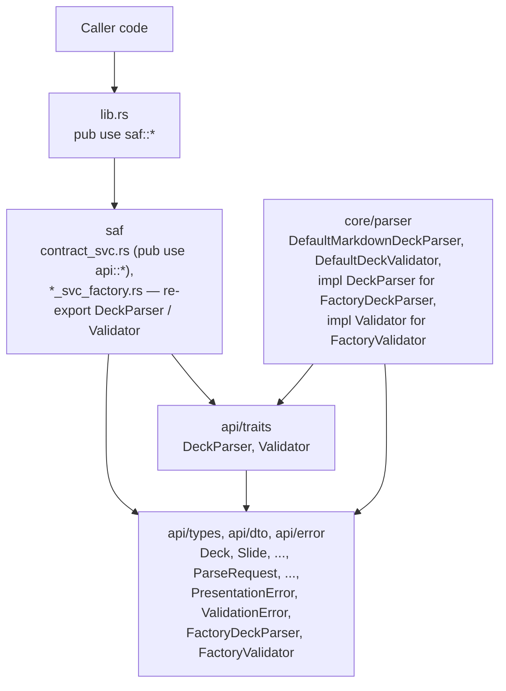
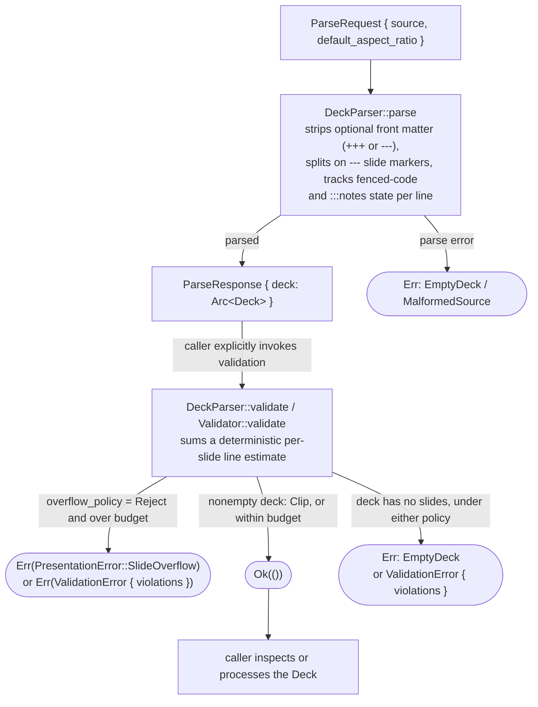

# Architecture

The [rules definition](rules_defination.md) is the reference for source syntax,
slide conventions, metadata, validation limits, and error behavior. This
document explains the module structure and design decisions that implement
those rules.

The Cargo package is `md-parser` and the Rust library import is `md_parser`.
For existing consumers, see the [rename migration guide](../4-development/developer_guide.md#rename-migration).

## What

`md-parser` transforms Markdown text into a `Deck` and separately
checks estimated slide content against a line budget. It is a single Rust
library crate organized into three internal modules:

- `api` — contracts and data declarations, with small default trait methods:
  - `api/traits/` — `DeckParser` (parse + validate a deck) and `Validator`
    (generic itemized validation), each with a default `factory()` method.
  - `api/types/` — `Deck`, `Slide`, `SlideElement`, `AspectRatio`,
    `OverflowPolicy`; `api/types/factory/` — `FactoryDeckParser`,
    `FactoryValidator` — one type per file.
  - `api/dto/` — `ParseRequest`, `ParseResponse`, `ValidateRequest`,
    `GetValidatorRequest`, `GetValidatorResponse`: the request/response types
    `DeckParser`'s methods use.
  - `api/error/` — `PresentationError`, `ValidationError` (declarations only).
- `core/parser/` — the real logic: `DefaultMarkdownDeckParser` (implements
  `DeckParser`) and `DefaultDeckValidator` (implements `Validator`, adapting
  `DefaultMarkdownDeckParser`'s validation into `Validator`'s itemized-error
  shape). This is also where `FactoryDeckParser`/`FactoryValidator` (declared
  in `api/`) get their own `DeckParser`/`Validator` impls, each delegating to
  the `Default*` type — `saf/` is a re-export facade, so trait impls for
  `api/`-declared types live in `core/`, not `saf/`. `core/error/` holds
  `PresentationError`'s `Display`/`Error` impls.
- `saf` — public re-export facade: `deck_parser_svc_factory.rs` and
  `validator_svc_factory.rs` each re-export their respective port trait
  (`DeckParser`, `Validator`) through the facade. The production
  implementations (`FactoryDeckParser`, `FactoryValidator`) are reachable via
  the crate root through `contract_svc.rs`'s existing `api::*` re-export.

`lib.rs` re-exports every public item from `saf`, so callers only ever import
from the crate root (`md_parser::{DeckParser, FactoryDeckParser,
ParseRequest, ...}`), never from `api`/`core`/`saf` directly — those module
names are an internal organizational detail, not part of the public API.

The public operations are:

| Operation | Result |
|-----------|--------|
| `DeckParser::parse(ParseRequest)` | `ParseResponse` containing `Arc<Deck>`, or `PresentationError` |
| `DeckParser::validate(ValidateRequest)` | `()`, or structured `PresentationError` |
| `DeckParser::validator(GetValidatorRequest)` | `GetValidatorResponse` containing `Arc<dyn Validator>`; the default uses `FactoryValidator` |
| `Validator::validate(ValidateRequest)` | `()`, or `ValidationError` with human-readable violations |

`FactoryDeckParser` and `FactoryValidator` are directly usable default
implementations. Each trait's `factory()` method returns its default entry
point independently of the caller's implementation. Generate the complete
API reference with `cargo doc --no-deps --open` from `scm/`.

## Why

The input is source text plus a default aspect ratio. The output is a deck
containing metadata, ordered slides, and ordered content elements. The parser
tracks code and notes blocks so their contents remain distinct from ordinary
slide text. These operations use only the Rust standard library.

Validation is explicit because successfully parsing text and meeting a slide
content budget are separate conditions. A caller can inspect a parsed deck
even when it exceeds the budget. Validation reads the deck without modifying
it and returns an error for an empty deck or a rejected overflow.

`api/` defines the types and callable contracts, `core/` implements parsing
and validation, and `saf/` exposes them through the crate root. The public
result is in-memory data; this library has no rendering or file-export API.

### Why a trait, not free functions

`DeckParser` defines parsing and validation operations. `FactoryDeckParser`
implements that contract as the default entry point. Callers can provide a
different implementation, including a test implementation as demonstrated in
`scm/tests/deck_parser_int_test.rs`. Parsing and validation logic stays in
`core/`, while `api/` exposes the contract and data.

### Why `Validator` as well as `DeckParser::validate`

`Validator::validate` and `DeckParser::validate` check the same fixed-canvas
constraint — `DefaultDeckValidator` (the default `Validator` implementation)
delegates through `DefaultMarkdownDeckParser`'s `DeckParser::validate` implementation rather than
reimplementing it. `Validator` exists as a second, generic entry point
because it reports failures as itemized `ValidationError { violations:
Vec<String> }` diagnostics rather than `DeckParser`'s structured
`PresentationError` variants — useful for a caller that wants a uniform
validation shape across multiple unrelated checks, without needing to know
`PresentationError`'s specific variants. The default implementation returns only the first failure as one message in `violations`; it does not collect all violations.

## Determinism

`DefaultMarkdownDeckParser::parse` and `::validate` are both pure: same
input, same output, every time. There is no floating-point arithmetic, no
locale- or platform-dependent behavior, and no reliance on iteration order
that isn't already source order. The line-count estimate behind
`SlideOverflow`'s `estimated_lines` is an integer computation over `char`
counts and `\n`-delimited line counts — reproducible across platforms.

## Module data flow

## Error handling

`PresentationError` is declared in `api/error/presentation_error.rs`; its
`std::error::Error` and `Display` impls live in `core/error/display.rs` so
that error-formatting logic stays in `core/`. `ValidationError` is a plain
struct wrapping `Vec<String>`. No `unwrap`/`expect` is used in the parser;
Clippy enforces this through the `unwrap_used`/`expect_used = "deny"` lint
configuration in `Cargo.toml`. Independently, `#![deny(unsafe_code)]`
forbids unsafe code at the crate level. Parse and validation failures return a
`PresentationError` (or, through `Validator`, a `ValidationError`) with
enough context — the offending slide number, the estimated line count, or a
message — for a caller to act on without re-parsing the source.
